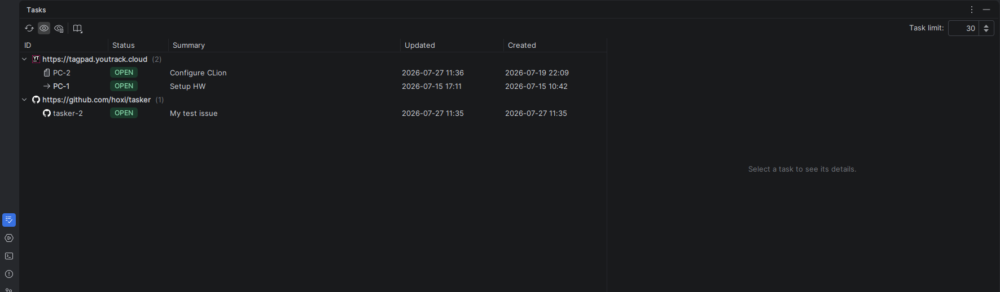
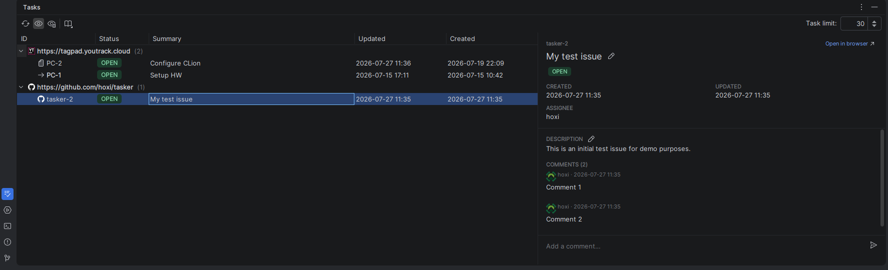
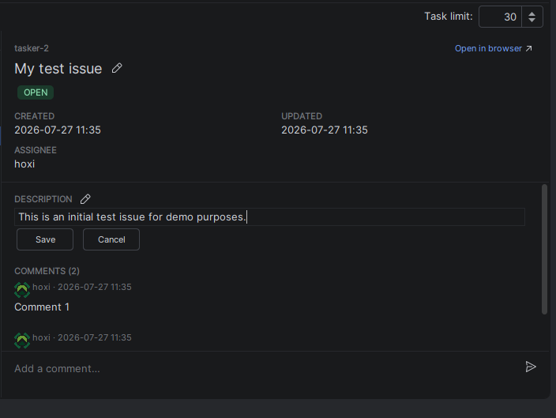
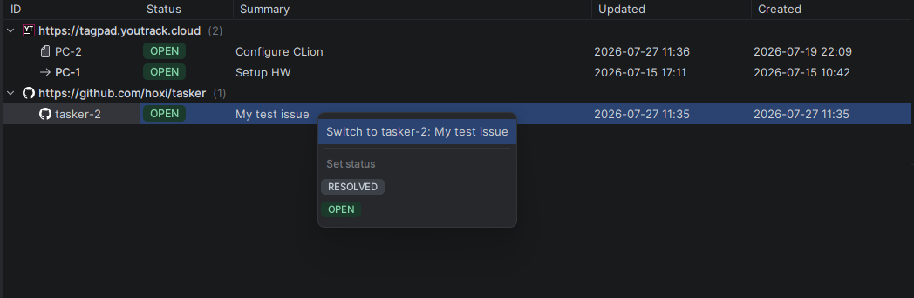

# Tasker



## Overview

An IntelliJ IDEA tool window that puts every issue from every configured task server in one sortable, groupable table —
with a details pane you can edit in place.

JetBrains' **Task Management** plugin already knows how to talk to your trackers, but it only surfaces them through a
search popup, one issue at a time. Tasker reuses those same server connections and shows the lot as a table you can
actually work in.

Task Management is no longer bundled with the IDE from **2026.2**: on 2026.2 and later, install
[Task Management](https://plugins.jetbrains.com/plugin/11545-task-management) from the Marketplace before Tasker.

Out of the box, Tasker lists and shows issues from **every** server type Task Management supports. For **GitHub**,
**GitLab**, **Jira** and **YouTrack** it goes much further, reading and editing what the platform leaves out: titles,
descriptions and comments edited in place, priorities and labels, linked pull requests, comment threads, reactions and
avatars, and each tracker's own status names. More server types may get the same detailed handling in the future.

## Requirements

- IntelliJ IDEA **2026.1** or newer (build 261+)
- The **Task Management** plugin (`com.intellij.tasks`) installed and enabled — Tasker depends on it outright and will
  not load without it. Bundled up to 2026.1; from 2026.2 it has to be installed manually, see below
- At least one task server configured under **Settings | Tools | Tasks | Servers**

Tasker adds no credentials or settings of its own. Every server, token and connection it uses is the one you already
configured for Task Management.

### Installing Task Management on 2026.2 and later

Task Management shipped with the IDE up to 2026.1. From **2026.2** it is no longer bundled, and has to be installed
manually: get [Task Management](https://plugins.jetbrains.com/plugin/11545-task-management) from the Marketplace —
**Settings | Plugins | Marketplace**, search for *Task Management* — then install Tasker. Tasker declares a hard
dependency on it, so without it Tasker will not load at all rather than degrading.

On 2026.1 and earlier there is nothing to do: Task Management is already there. Either way Tasker asks for the plugin by
id and uses it wherever it comes from.

## The task list

Opens as the **Tasks** tool window at the bottom of the IDE.

- **Columns** — ID, Status, Assignee, Summary, Updated, Created. Assignee comes from the GitHub, GitLab, Jira and
  YouTrack adapters, and is blank for other servers. Click a header to sort by that column, Shift+click to add it as a
  further sort; drag to reorder anything except ID, which stays pinned to the left because it carries the tree.
- **Sorting** — the *Sort* button opens a popup for sorting by several fields at once: drag the rules into order, pick
  each one's direction ("Newest first", "Highest first"), and rank assignees, for example *Me*, then a colleague, then
  everyone else. Status sorts in workflow order, empty values always go last, and ties keep each server's own order.
  Assignee and priority come from the GitHub, GitLab, Jira and YouTrack adapters; other servers' rows sort after
  theirs. Changes apply as you make them, and *Reset* goes back to each server's own order.
- **Grouping** — tasks sit under their server by default. Turn *Group by Server* off for a flat list, where each row
  shows its server's icon instead.
- **Status** — rendered as a coloured badge using the tracker's own state name, not a flattened approximation of it.
- **The active task** is marked with a right arrow and bold text, and it updates the moment you switch, however you
  switch.
- **Closed issues** are hidden by default and greyed when shown.
- **Task list limit** caps how many issues are requested from each server. Lower is faster; the default is 30.
- **Dates** follow the IDE's own date format, as set under *Settings | Appearance & Behavior | System Settings*.

Grouping, closed issues, the task limit and the sort column are remembered per project.

Servers load in parallel and the tree fills in as each one answers, so a slow tracker never holds up the rest. One that
fails says so on its own row and leaves the others alone.

Everything read from a server — the lists, and each task's details, comments, fields and pull requests — is kept for as
long as Task Management keeps its own issue cache: *Update issue cache every N minutes* under **Settings | Tools |
Tasks**, 20 by default. Toggling *Show Closed Issues* or lowering the limit shows a list already held instead of asking
every server again, and revisiting a task is instant. While the tool window is showing, anything older is read again in
the background and swapped in; with that setting switched off, nothing is. **Refresh** always asks every server afresh.

## The details pane



Select a row and the pane shows the issue's id, title, status, labels, dates, priority and whatever other fields the
tracker exposes, its description, any linked pull or merge requests, and its comments. Comments and the full description
are fetched lazily on selection and cached, so the list load never pays for them.

- **Comments** are rendered as the tracker renders them, with the author's avatar. Replies sit indented under the
  comment they answer wherever the tracker says which one that is, and emoji reactions are tallied below each comment —
  your own highlighted.
- **Pull requests** lists the pull and merge requests linked to the issue, each with its state and a link to it. For
  GitLab merge requests, *Show in IDE* opens the GitLab plugin's Merge Requests tool window.

### Editing in place

The pen next to the **title** and the **description** turns them into editable text right where they sit — no dialog, no
jump.

- `Enter` commits a title, `Escape` cancels
- The description has Save and Cancel buttons; `Escape` cancels
- The composer at the foot of the pane posts a comment — `Enter` sends, `Shift+Enter` inserts a newline, `Escape`
  discards the draft
- A pen next to **your own comments** rewrites them in place, with the same Save, Cancel and `Escape` as the description



An action that a tracker can't perform is greyed out with a tooltip explaining which of the two reasons applies: the
provider doesn't support it at all, or this particular issue isn't addressable.

## Right-click menu



- **Switch to `<task>`** hands the issue to Task Management exactly as its own *Open Task* chooser does:
  an issue you've already worked on is activated outright, a new one opens the Open Task dialog, which is where the
  changelist, branch and context options live.
- **Set status** lists only the transitions the server says are legal from the issue's current state, so a Jira workflow
  offers just the steps it actually permits.

## Toolbar

|                        |                                                                                                                                                  |
|------------------------|--------------------------------------------------------------------------------------------------------------------------------------------------|
| **Refresh**            | Reload every server and drop cached comments — done for you after the servers are reconfigured                                                   |
| **Group by Server**    | Toggle the per-server tree                                                                                                                       |
| **Show Closed Issues** | Fetch and show closed/resolved issues too                                                                                                        |
| **Sort**               | Sort by several fields, and rank assignees — see *Sorting* above                                                                                 |
| **Tasks & Contexts**   | The bundled plugin's own menu — Switch Task, Open Task, Close Task, Save/Load/Clear Context, Configure Servers — without going to the Tools menu |
| **Task list limit**    | Issues requested from each server                                                                                                                |

## What works per provider

Every server type Task Management supports is listed and shown: Bugzilla, Forgejo, FogBugz, Generic, GitHub, GitLab,
Jira, Lighthouse, Mantis, PivotalTracker, Redmine, Trac, Trello and YouTrack. GitHub, GitLab, Jira and YouTrack also
get a provider adapter, which is what the extra columns below come from; more server types may follow.

Status changes go through the platform, so they work with **any** tracker that reports support for them. Everything else
needs a provider adapter, because the platform's task API has no notion of renaming an issue, editing its description,
or posting a comment.

| Provider                   | Rename | Description | Comment | Edit own comments | Reactions | Linked PRs | Extra fields shown                                     |
|----------------------------|:------:|:-----------:|:-------:|:-----------------:|:---------:|:----------:|--------------------------------------------------------|
| GitHub                     |   ✅   |     ✅      |   ✅    |        ✅         |    ✅     |     ✅     | Assignee, labels (coloured)                            |
| GitLab                     |   ✅   |     ✅      |   ✅    |         —         |     —     |     ✅     | Assignee, Time spent, Estimate, labels                 |
| YouTrack                   |   ✅   |     ✅      |   ✅    |        ✅         |    ✅     |     ✅     | Priority (coloured), Type, Assignee, tags (coloured)   |
| Jira                       |   ✅   |     ✅      |   ✅    |        ✅         |     —     |     ✅     | Type, Priority (with icon), Assignee, Reporter, labels |
| Redmine, Trac, Bugzilla, … |   —    |      —      |    —    |         —         |     —     |     —      | —                                                      |

Notes:

- **YouTrack's fields come free** — it's the only bundled provider that populates the platform's custom properties, and
  Tasker renders that map generically. `Type` only appears if your YouTrack project defines a custom field named exactly
  `Type` and the issue has a value for it.
- **GitLab's "Time spent" is real** — it's what everyone has logged against the issue, read from
  `time_stats`. GitHub's issue API has no time tracking at all.
- **Jira shows its own status names and issue-type icons** — "In Review" rather than a generic "Open", and the Bug or
  Story icon rather than a blank. The bundled connector reduces both away (Cloud serves the icons as SVG, which it can't
  decode), so Tasker reads them back over the REST API after the list loads.
- **Jira's linked pull requests** come from the issue's Development panel, which only Atlassian's undocumented
  `dev-status` API exposes. If that stops answering, the section simply doesn't appear. Jira reactions aren't shown at
  all: Atlassian serves them only to its own web UI, and refuses API tokens.
- **GitHub's linked pull requests** are those that mention the issue. One linked only through the sidebar's Development
  box, without ever mentioning it, isn't visible to the REST API.
- **"Tracked in IDE"** is a separate row, shown for any provider once you've switched to the task. That one is the IDE's
  own stopwatch, not anything the tracker knows about.
- Adding milestones or due dates is a line per adapter — the plumbing is generic.

Providers without an adapter still list, sort, group, show their details and comments, and change status perfectly
well; they just can't be edited from the pane, and show only what their connector provides.

## Building

Needs JDK 25.

```bash
./gradlew buildPlugin      # -> build/distributions/Tasker-<version>.zip
./gradlew runIde           # launch a sandbox IDE with the plugin loaded
./gradlew verifyPlugin     # run the JetBrains plugin verifier
```

Install the built zip through **Settings | Plugins | ⚙ | Install Plugin from Disk…**.

## Licence

[MIT](LICENSE) © 2026 Magnus Wållberg
